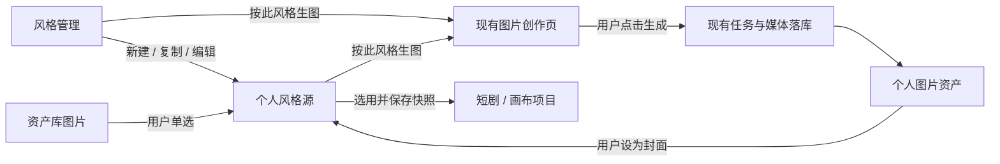

# 个人风格管理与资产封面设计

状态：本次新增管理入口、资产库选择封面与 AI 填写风格配置，复用现有画布风格中心和文本任务。下文的封面资产绑定、生图与短剧联动保留为后续方案，不属于本次实现。

## 本次实现范围

- 在“账户与设置 → 创作 → 风格管理”提供入口，地址为 `/settings?section=styles`，进入后默认显示“我的风格”。
- 设置页直接内嵌既有风格中心，共用原有列表、编辑器和个人风格 CRUD 接口；支持新建、查看、复制、收藏、编辑和删除。
- 系统风格只允许查看、收藏与复制，个人风格保留原有编辑、删除能力；不新增风格表或接口。
- 管理入口不关联项目，隐藏卡片、详情和编辑器中的应用操作，保存仅写入个人风格库。画布原入口继续保留选用与“保存并应用”。
- 封面沿用现有 URL 字段，保留手填地址，并增加“从资产库选择”；仅允许图片单选，支持选用远端分页中尚未缓存到本机的图片。已在服务端的图片直接复用稳定资源 URL；本地图片先上传，上传失败时保留选择并提示重试，不保存临时预览地址。
- 确认图片后先回填封面并预览，点击保存风格后才写入个人风格库。本次不增加 `coverAssetId` 后端绑定，按风格生图与短剧选用个人风格暂不扩展。
- 新建、编辑风格时，在“保存到我的风格”前提供“AI 帮我填写”。用户输入最多 4000 字的风格想法，沿用默认文本模型或自行更换，点击“生成并填入”后补齐名称、简介、标签、正向 Prompt、负面约束、题材世界／视觉媒介／叙事气质／角色造型及执行策略。
- AI 只回填当前草稿，用户检查和修改后再手动保存。现有封面、执行资产、来源身份与版本原样保留；模型不能编造图片 URL、LoRA、模板或资源 ID。返回内容必须满足完整 JSON、字段白名单、类型和长度校验，失败时保留原草稿，不部分覆盖。
- 关闭填写窗口、切换草稿或账号后不回填迟到结果。停止填写时按现有任务规则尝试取消同一账号的可取消任务；已提交到上游的请求遵循原有取消边界，不把停止页面监听当作上游已经停止。

以下第 1–7 节为后续完整方案，尚未实施的内容以本节范围为准。

## 1. 产品规则

| 对象 | 查看 | 复制到我的风格 | 编辑／删除 | 按此风格生图 |
| --- | --- | --- | --- | --- |
| 系统风格 | 支持 | 支持 | 不允许 | 支持，产物进入个人资产库 |
| 我的风格 | 支持 | 支持 | 仅本人允许 | 支持，结果可选作封面 |

- 个人风格按账号保存到服务端，跨设备读取；不会发布给其他用户。
- 复制创建独立草稿，默认命名为“原名称 副本”，保存后得到新 ID。修改副本不改变原风格。
- 封面是展示样图，默认不会作为生图参考图发送。已有风格中的参考图、LoRA 等执行资产仍遵循各入口的实际支持范围。
- 删除个人风格只删除风格源记录，保留资产库里的图片和已制作项目中的快照。
- 项目选用风格时保存内容快照。库内后续编辑只影响再次选用；不会自动重写项目、重新生成图片或修改分镜。

## 2. 页面与交互

### 2.1 账户与设置 → 创作 → 风格管理

入口为 `/settings?section=styles`，沿用现有设置导航和 pane，不新增一级工作台入口。

```text
风格管理                                      [新建风格]
保存自己的画面风格，供短剧与画布选用

[我的风格] [系统风格]             [搜索名称、简介、标签]

┌──────────────┐  ┌──────────────┐  ┌──────────────┐
│   风格样图   │  │   风格样图   │  │   风格样图   │
│ 名称         │  │ 名称         │  │ 名称         │
│ 简介、标签   │  │ 简介、标签   │  │ 简介、标签   │
│ [查看] [⋯]   │  │ [查看] [⋯]   │  │ [查看] [⋯]   │
└──────────────┘  └──────────────┘  └──────────────┘
```

- 默认打开“我的风格”；空态提供“新建风格”和“从系统风格复制”。
- 我的风格菜单：编辑、复制、按此风格生图、删除。删除时说明“已有项目和资产图片会保留”。
- 系统风格菜单：查看、复制为我的风格、按此风格生图。没有编辑、删除、替换封面操作。
- 画布与短剧目前有不同的系统风格目录。首期保留原目录，在管理页系统视图按“短剧／画布”切换，默认短剧；不重编预设、不合并相同名称。列表身份包含目录来源，防止不同目录中的同名 ID 冲突。
- 全部个人风格使用同一份服务端数据；不再区分“短剧个人风格”和“画布个人风格”。

### 2.2 新建、编辑和复制

复用已有风格编辑器，默认展示基本字段，执行配置收在高级设置中。

| 区域 | 内容 |
| --- | --- |
| 左侧预览 | 封面、名称、简介、标签；无图时为中性占位 |
| 基本信息 | 名称、简介、标签；沿用现有长度校验 |
| 风格说明 | 正向提示词必填；负面约束可选 |
| 封面 | 从资产库选择、更换、移除；图片单选 |
| 高级设置 | 沿用画布已有的执行资产与策略，不新增训练、模型或参数体系 |
| 底部操作 | 取消、保存；离开未保存草稿时提示 |

设置页只保存到个人库，不显示“保存并应用到项目”。选用弹窗保留各业务的应用行为；短剧仍先更新配置草稿，再沿用“保存调整”或阶段确认流程。

封面可不设置。新建和替换封面通过资产选择器完成，首期不增加直接填写外部 URL 或独立上传通道；需要本机图片时先按资产库现有流程上传。

### 2.3 复制时的图片

- 复制个人风格：复用同一张资产图片的引用，不重复上传、复制文件或创建图片资产。
- 系统样图继续使用现有静态资源，系统目录不迁移。复制为个人风格时，如果同时保留系统样图，则在保存副本时通过现有资源上传与资产创建流程，把样图纳入本人的图片资产，再绑定封面；不把任意静态 URL 当作个人资产。
- 没有样图的系统风格可直接复制文字内容。样图导入失败时保留草稿，允许重试或移除封面后保存；不声称文件已入库，也不重复创建已经成功导入的资产。

### 2.4 按此风格生图 → 入资产 → 选作封面

点击已保存风格的“按此风格生图”，进入现有 `/create` 图片创作页，携带选中风格的内容快照；不自动提交付费生成任务。

1. 创作页显示“已使用：风格名称”，用户补充画面内容，例如“一位女子站在雨夜街头”。风格规则与画面内容分开保存，提交时使用现有风格编译逻辑组合，避免重复拼接。
2. 图片模型、画幅、分辨率、张数继续使用现有创作控件与真实模型能力，默认单张；不固定所有模型都支持 1K／2K／4K。
3. 用户点击生成，沿用当前报价、计费、任务队列、取消、恢复和资源落库流程。封面图不自动变成参考图。
4. 图片成功且资产注册完成后，显示“已保存到资产库”，提供“在资产库查看”。入库未完成时明确显示“保存中／保存失败，可重试”，不能把临时预览当作已入库图片。
5. 从个人风格发起时，结果另提供“设为此风格封面”。用户点击后才更新封面，保留该风格其余最新字段；多张结果由用户选一张，不自动采用第一张。按任务 ID、输出索引及实际资源定位资产，不能用过滤后的资产数组位置猜测对应图片。
6. 从系统风格发起时，不更新系统封面。结果可用于普通资产，也可点“复制为我的风格并使用此封面”，进入已预填内容的个人风格草稿。

编辑器中的新建／未保存风格先保存，再从风格列表发起生成。首期不维护一套额外的“未保存风格生成会话”。

跳转创作页时保留已有会话和未发送草稿，为这次风格试作建立独立会话；风格快照、来源风格 ID、来源版本和返回入口随创作消息／任务记录保存。消费路由状态后清除该状态，刷新恢复依赖持久会话及任务，不能只依赖 `location.state`。



## 3. 复用现状与必要改动

以下为本次代码核对结果，不代表新设计已实施。

| 能力 | 已有实现 | 本期改动 |
| --- | --- | --- |
| 个人风格 CRUD | `web/src/services/api/style-profiles.ts`、`backend/internal/prompts/style_profile.go`，已有用户隔离、版本号和最多 200 条限制 | 继续使用原接口和 `StyleProfile` 表；补封面资产校验与编辑冲突处理 |
| 系统／个人列表和复制 | `canvas-style-picker-modal.tsx`，已有查看、复制、编辑、删除等动作 | 抽出实际共用的风格列表与动作供设置页和选择弹窗复用；不把设置页嵌成一个常开的画布弹窗 |
| 风格编辑器 | `style-profile-editor-modal.tsx` | 增加管理模式，封面 URL 输入替换为资产单选；高级执行配置默认收起 |
| 资产选择 | `components/assets/asset-library-picker-modal.tsx` | 使用远端图片筛选、单选和远端结果；不依赖本机资产缓存是否恰好包含该图片 |
| 生成与入库 | `services/api/generation-task.ts`、`services/project-asset-sync.ts`、`backend/internal/app/task_media_assets.go` | `/create` 增加风格携带与结果回填动作；复用任务和输出索引的幂等入库，不另开供应商请求 |
| 短剧系统风格 | `lib/drama/drama-styles.ts`、`pages/projects/style-picker.tsx` | 增加“我的风格”，选择器返回完整内容，创建和引导不再只根据 ID 查静态数组 |
| 画布项目快照 | `StyleProfileSnapshot`、`Project.StyleProfileJSON`、`use-canvas-style-workflow.ts` | 保留原快照合同；设置页不调用会修改项目／画布节点的 workflow |

已有系统收藏、最近使用采用未隔离的本地键。共用组件接入时，查询键及这些本地偏好按当前用户 scope 隔离，避免切账号后串数据；不新增收藏或排序体系。

## 4. 最小数据合同

### 4.1 个人风格与封面

沿用 `StyleProfile` 及其 `profileJson`，在既有快照中增加一个可选 `coverAssetId`，不新增风格图片表。

| 字段 | 用途 |
| --- | --- |
| `id`、`sourceProfileId`、`revision` | 继续使用服务端管理的个人风格身份和版本 |
| `title`、`description`、`tags` | 名称、简介、标签 |
| `prompt`、`negativePrompt` | 长期稳定的风格规则与负面约束 |
| `coverAssetId` | 选择的个人图片资产身份 |
| `coverUrl` | 服务端根据资产解析的稳定资源访问路径；继续供现有展示与资源引用扫描使用 |
| `assets`、`executionPolicy` | 保留现有执行资产合同，基本新建风格默认无执行资产 |

保存新封面时，后端校验资产属于当前账号、类型为图片、可用且具有已落库资源，再解析实际资源路径；不能只相信客户端传入的 URL。不保存 `blob:`、Base64 图片正文、临时签名地址或本机缓存地址。原有手填 URL 的历史风格保持可读取，替换封面后进入资产绑定合同，不批量迁移历史封面。

更新／删除个人风格补 `expectedRevision`，按数据库条件原子判断；冲突返回 409 并保留用户草稿。版本号由服务端递增，禁止客户端指定他人风格身份或把副本写回系统目录。结果设封面时读取最新版本，只修改封面；若提交期间再次变化则提示刷新，不覆盖其他字段。

### 4.2 短剧选用快照

短剧当前只有 `styleName/stylePrompt`。本期增加可选的 `settings.styleProfileJson`，复用 `StyleProfileSnapshot` 保存名称、提示词、简介、封面和来源版本；应用时从该快照投影原有 `styleName/stylePrompt`，生产流水线继续消费原字段。投影由后端沿用既有风格文字编译规则，包含正向提示词、负面约束及通过现有校验的 `kind=prompt` 文字片段／触发词，不能只取 `snapshot.prompt` 而丢掉其余文字约束。

- 创建草稿也保存快照。恢复时优先恢复已保存内容，源风格被编辑或删除仍能继续制作，不按过期 ID 重新猜风格。
- 引导页左侧风格预览优先使用项目快照，不再只靠提示词与静态预设相等来找图片。
- 传统项目没有快照时仍按现有名称与提示词显示，不借此改写旧项目。
- Agent 按文字重新定义风格时，同步重建项目文字快照，并清理不再匹配的来源关联和旧封面；保存到个人库必须由用户点击“保存为我的风格”，不能把每次推荐自动写入库。
- Agent 读取与选择个人风格时只读取当前用户候选，选项继续使用现有确认和配置保存协议；不新增一套 Agent 写库工具。

短剧首期支持文字风格，继续使用现有提取、分镜和提示词流程。已有个人风格若包含启用的 LoRA／模板／参考图执行资产，或启用但尚未通过现有校验的文字资产，在短剧选择器注明原因并禁用选用；避免只应用部分内容却声称完整执行。画布保留原有高级执行能力，短剧的高级资产执行不在本期扩展。

## 5. 图片与删除边界

- 个人封面与生成图走现有 `Resource → 资产` 存储，服从当前用户存储配置、配额及访问权限；绑定已有资产不再上传文件。
- 删除／改名风格、复制风格、替换封面都不删除图片资产。解除封面只去掉引用，由用户在资产库自行管理图片。
- 已有风格 `CoverURL/ProfileJSON` 会进入资源引用扫描，继续复用该能力。当前用户明确“彻底删除资产”的合同允许项目／风格中的旧资源引用失效，本期不改动全局彻底删除语义：封面丢失时显示占位并允许重选，不删风格、不自动生图补偿。
- 生成期间风格被编辑或删除，任务仍按提交时快照完成，图片正常入库。来源风格不存在时隐藏“设为原风格封面”，保留资产与“复制成新风格”入口。
- 页面离开或切账号后，不执行旧页面的封面回填；生成结果由原账号任务正常保存，重新进入后再恢复查看。
- 供应商生成成功但文件入库失败时，恢复同一任务的媒体保存；重试入库不再次调用模型。任务 ID 与输出索引沿用现有去重身份。

## 6. 实施任务划分

先确定上述字段与组件接口，再并行实现，避免不同入口各做一套个人风格。

| 任务 | 范围 | 依赖与完成标准 |
| --- | --- | --- |
| A：数据与后端 | 资产封面校验、快照解析、个人风格 expectedRevision、短剧快照保存 | 先冻结合同；越权、非图片、无资源与过期更新明确失败，原任务与存储入口不变 |
| B：管理页面 | 设置导航、共用风格列表、编辑器管理模式、复制与资产单选 | 基于 A 接口与现有 CRUD 并行开发；系统无删改入口，个人可完成管理闭环 |
| C：业务选用 | 短剧创建／草稿恢复／引导预览、“保存为我的风格”、画布共享个人源 | 基于 A 快照合同并行开发；删改源不影响已有项目，原 CAS 和制作流程继续生效 |
| D：生图闭环 | `/create` 风格携带、任务上下文恢复、结果入资产与设封面 | 基于 A 与既有生成服务并行开发；用户主动生成，刷新可恢复，入库和回填都不重复计费或覆盖新设置 |
| E：整体验收 | 账户隔离、系统只读、复制、封面、快照、生成恢复、明暗主题与窄屏 | A–D 合并后验证真实主流程，补对应 API／数据库／待测试文档 |

本期不做公共风格市场、分享审批、风格训练、图片反推风格、批量样图评测或项目全量同步更新。

## 7. 验收主流程

1. 从系统风格复制 → 修改文字 → 资产库选图 → 保存到我的风格；系统原项不变，个人图片可在资产库找到。
2. 从我的风格生图 → 用户明确提交 → 图片入资产 → 用户设为封面；刷新和重新登录后仍可看到同一风格及图片。
3. 直接用系统风格生图，生成结果可复用，但系统封面与内容不能被修改。
4. 画布与短剧能看到同一用户的文字风格；其他账号不可见、不可读取、不可修改。图片资源同样校验归属。
5. 项目或创建草稿已选个人风格后，在设置中编辑／删除源；原项目继续使用旧快照，不丢失风格内容，也不自动重生成。
6. Agent 生成的自定义文字风格可显式保存到个人库；不自动保存每轮推荐，不在更新提示词后继续展示上一种风格的样图。
7. 多端同时编辑、入库失败恢复、来源删除后生成完成、封面资产被彻底删除时，都有明确状态，不出现覆盖、重复生成或错误成功提示。
