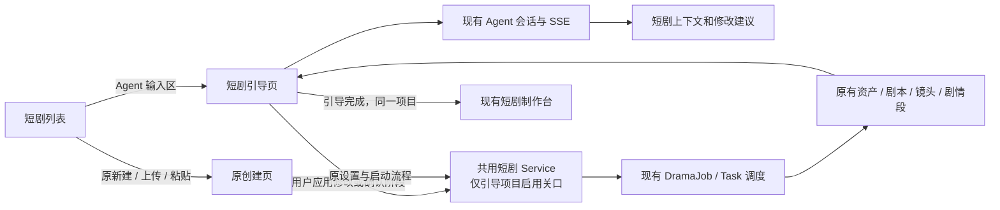

# 短剧 Agent 引导创建实现方案

状态：主流程已实现，待真实环境验证。正式功能位于现有短剧页面、CloudAgent 和 Drama 流水线；本地交互原型仅保留为设计参考，不作为正式功能验收依据。

本次按互不重叠的三个任务完成实现，再统一整合验证：

| 任务 | 范围 | 验收重点 |
| --- | --- | --- |
| 短剧流程 | 持久引导状态、正文保存、阶段确认、调度与编辑校验 | 传统流程回归、三个确认、零图完成、并发与旧结果保护 |
| Agent 复用 | 显式短剧上下文、建议工具、全局唯一面板内嵌与会话恢复 | 归属与会话隔离、工具白名单、建议只读、刷新回放 |
| 产品前端 | 列表输入区、引导路由、配置与成果审阅、原制作台交接 | 原入口保留、真实 API 与现有样式、明暗主题及窄屏 |

验证结果与尚待真实模型联调的项目记录在 `docs/content/docs/progress/pending-test.mdx`。

## 1. 核心决策

短剧 Agent 作为现有 CloudAgent 的一个业务场景，复用会话、模型调用、流式输出、历史与运行恢复。短剧生成继续使用现有 Drama 流水线。新增引导页面、短剧上下文适配和少量服务端确认关口。

Agent 引导主流程保留三个确认动作：**确认制作方案 → 确认资产文字 → 确认剧本、分镜与提示词**。全部文字确认后结束引导，进入同一项目的现有制作台。图片按需生成，零图片也能完成。

**保留两种创建方式：只有从 Agent 入口创建的引导项目才增加文字确认关口。空列表合并为一个创作区；有作品时仍可从页头进入原上传、粘贴正文流程，原创建页及配置/启动行为保留，不增加这些暂停点。**

| 创建入口 | 项目标记 | 执行方式 |
| --- | --- | --- |
| 新增列表顶部 Agent 输入区 | guided=true，guideStep=configuring | 按引导阶段生成、等待用户确认，完成后进入原制作台 |
| 原新建/上传/粘贴入口 | 不传 guided，guideStep 为空 | 沿用原创建页、设置与启动行为，文字连续执行，媒体遵循原 mediaMode/reviewMode |

是否启用关口根据项目持久化的引导状态判断，与当前打开的页面、是否展开 Agent 聊天、mediaMode 是否为 manual 无关。进行中的 Agent 项目刷新或重进后仍恢复原关口；传统项目不会因为打开 Agent 面板就变成引导项目。首期不增加传统项目与引导项目互相转换的操作。

第一版不新增独立 Agent 服务、多 Agent 分工、通用工作流引擎、第二套任务/资产表，也不要求创建画布。精修时继续使用现有按需创建画布的能力。

## 2. 现有能力与实际缺口

下表记录改造前的复用基线与本次实现落点。已完成本地专项测试、类型检查、构建与 lint，真实模型和部署环境仍待验证；具体范围见待测试文档。

| 范围 | 现有实现 | 本次处理 |
| --- | --- | --- |
| 项目创建 | `drama_service.go:27` 的 CreateDrama 支持 start=false，原文、设置与项目统一落库 | 复用；补仅有创作简述的引导草稿分支 |
| 文本流水线 | `drama_orchestrator.go:400`：bible → 分集 → script/镜头表 → segment_prompt | 保留现有任务与结果结构，插入确认关口 |
| 手动生成 | `drama_types.go:94` 的 manual 阻止自动媒体，不阻止继续生成文字 | Agent 引导项目固定 manual；传统入口的选项及行为不变，不能用 manual 判断是否启用关口 |
| 资产提取 | `drama_orchestrator.go:786` 的 bible 单任务一次落库角色、场景和道具 | 按真实结果分类展示，不拆成三种任务/三次确认 |
| 文本编辑 | `drama_actions.go:271,333` 等已有设定、镜头、段提示词编辑及重写 | 复用这些业务入口 |
| 图片 | `drama_actions.go:567` 可单张请求参考图；不必全局放行 | 引导只提供单张生成，制作台沿用已有批量能力 |
| 制作台 | `web/src/pages/projects/detail.tsx` 及 `studio/` 子组件 | 原页面继续承担生成视频、重试、成片等制作职责 |
| Agent 对话 | `cloud_agent.go:137,373` 已允许无画布运行 | 复用运行内核；无画布运行目前仍不等于短剧项目上下文 |
| Agent 短剧工具 | `cloud_agent_drama.go:79` 的 drama_get_context；另有采用画布媒体工具 | 复用读取主体；新增结构化修改建议适配 |
| Agent 上下文 | `cloud_agent.go:235,524` 当前只允许 canvas scope，短剧从关联画布推导 | 增加显式短剧项目绑定，不伪造画布 ID |
| 流式输出/恢复 | `handler/agent.go:365`、`api/agent.ts:237`、`repository/cloud_agent.go:44` | 复用 SSE、会话 ID、父轮续聊与持久事件 |

重要区别：现有 ApproveDramaEpisode 会推进视频阶段，ReleaseDramaMedia 的 episodes/all 会放行视频，二者均不能直接作为“结束引导”。

## 3. 用户主流程

### 3.1 两条入口并存，Agent 入口创建引导草稿

在现有短剧列表上方增加 Agent 输入区，支持创作简述、粘贴正文、上传现有已支持的 TXT/Markdown。没有作品时只显示该输入区，并将五步制作说明合并到输入框下方，删除重复的旧上传卡片。有作品时保留页头原上传、粘贴正文入口及 `/projects/new` 创建页，用户仍可直接填写设置并按原方式开始制作。Agent 输入区中的上传/粘贴进入引导路径。保留列表、筛选与既有作品入口。PDF/Word 不因原型展示过就视为已支持。

用户在 Agent 输入区点击“开始创作”，显式携带 guided=true、start=false 创建同一份引导项目草稿，随后进入 `/projects/:projectId/guide`。创建成功后后续操作固定使用返回的项目 ID；失败按现有错误处理，不自动改名重建另一项目。传统创建请求不携带 guided，继续使用原 start 与跳转逻辑。

两类输入明确区分：

- **已有小说/剧本/分镜正文**：复用现有解析、章节选择与 sourceFormat 合同。
- **一句灵感/创作简述**：独立保存 brief；允许这类引导草稿暂时没有正文。由同一个 Agent 先给出可编辑的故事草稿，用户应用后保存为普通章节。正文未准备好前不能启动改编。不能把一句 brief 当成完整小说来绕过校验，也不扩展成长篇小说创作系统。

引导覆盖本次选择的制作章节。默认建议小范围试作，范围通过现有 selectedChapters、episodeMode、chaptersPerEpisode 实现。只有实际按章形成一集时才显示“先做第 1 集”；自动分集则显示所选章节，不虚构固定集数。其他章节继续使用现有预留机制。

### 3.2 对话确认制作方案

左侧复用 Agent 对话，右侧显示简要制作方案；优先推荐默认值，用户可以对话调整或直接编辑。

右侧提供“请 Agent 起草正文与方案”或“请 Agent 推荐方案”按钮，将已保存的创作简述或正文读取要求送入同一会话，无需用户重复输入。Agent 只提出待应用建议；首次消息才创建服务端会话，加载页面和恢复历史不自动发送收费请求。

默认展示画幅、风格、对白语言、单集目标时长、视频清晰度、制作范围。模型、图片方案、分镜规则等沿用现有配置，放入折叠的“更多设置”。

| 产品配置 | 复用字段 |
| --- | --- |
| 画幅 | settings.aspectRatio |
| 风格 | settings.styleName / stylePrompt |
| 对白语言 | settings.language |
| 单集目标时长 | settings.episodeSeconds，属于改编目标，不承诺最终精确秒数 |
| 视频清晰度 | settings.videoResolution，取视频模型支持的选项 |
| 资产图片尺寸 | settings.assets.resolution / propResolution / sceneResolution，取对应图片模型能力 |
| 模型与步骤覆盖 | settings.models 及已有 bibleText/scriptText/promptText 等字段 |

视频的 720p/1080p 与资产图片的 1K/2K/4K 分开。Agent 推荐值同样要通过服务端模型能力校验，不硬编码全部模型支持 1080p 或 4K。

`drama_get_context` 在 `guide.videoModel` 返回所选视频模型的真实画幅、清晰度选项与默认值；不可用时返回原因，仍可读取作品上下文。Agent 从这些选项推荐清晰度，画幅单独设置，不自行把 `1080p` 改写成 `1080x1920`。`setup` 建议仅在配置阶段可提出，合并当前设置后复用保存接口的只读校验，错误建议不进入待应用卡片。已有建议可点击“调整建议”带入原配置表单，保留风格、语言等字段，手动改选清晰度后显式保存；不覆盖已有未保存草稿，不自动转换或降档。

“确认配置，开始提取资产”保存真实设置、确认正文就绪并启动既有 bible 任务。引导项目固定 mediaMode=manual。画幅和分集方式沿用现有锁定规则；首期不增加自动迁移画幅或全局配置改变后的复杂重建机制。

### 3.3 确认资产文字

bible 完成后展示角色、场景、道具文字卡，包含真实名称、描述、外观与声音等已有字段。先显示实际任务状态，结果落库后显示卡片；不为逐卡动效拆任务，也不伪造后台逐个产出的进度。

用户可直接编辑，或向 Agent 描述修改方向。所有实际改动写回原 DramaCast。每张卡可点“生成参考图”，调用既有单张生成服务；没有图片、图片失败、图片仍生成中，都不阻塞文字确认。

点击“确认资产设定，继续改编”后，才允许现有分集、剧本、镜头表和段视频提示词任务继续执行。

### 3.4 确认剧本与分镜，结束引导

右侧复用现有剧本文字、镜头表、剧情段和提示词数据。视频生成单位仍是 DramaSegment，不能把原型里的“每镜一条提示词”固化为真实合同。

生成剧本时现有逻辑可能补出新角色、场景、道具与造型。因此审阅区也展示“本阶段新增设定”，最终确认覆盖本次制作范围的全部文字成果，数量以接口数据为准。

用户可用现有镜头编辑、提示词覆盖、重新改编能力调整内容。需要重新调用模型时明确选择对应集，不因一句模糊反馈静默重写全剧。

全部所选集的剧本、镜头和段提示词就绪后，点击“确认并进入制作台”，保存最终确认后跳转既有 `/projects/:projectId`，不重新创建项目、复制资产或再次生成文字。重新访问已完成的引导路由时展示已完成状态，仍可进入同一制作台。

## 4. Agent 复用方式

### 对话层共用，页面按场景展示

现有 CanvasCloudAgentPanel 已是平台统一入口。给现有会话控制增加内嵌展示位置，尽量复用消息、输入、结构化提问、SSE 与恢复；不复制大面板控制器，也不同时挂载两份会话实例。进入引导后同一 Agent 在左栏展示，离开后恢复全局入口。

若当前控制器与浮层布局耦合，只抽出这次确有两个调用方的会话控制部分，不借机重构整个 Agent 架构。

### 增加短剧业务作用域

请求与运行视图增加 dramaProjectId，contextScope 支持 drama。短剧引导要求 permissionMode=read_only，不能同时传 canvasId、焦点节点或固定技能。服务端从已校验的项目绑定读取数据，校验当前用户归属；工具参数不能任意指定另一个项目。

画布作用域保留现有行为。引导期使用短剧绑定，不传 canvasId；Task.ProjectID 当前承担画布语义，不能把短剧 ID 直接塞进去。短剧绑定保存在 Agent 请求/执行上下文中，并纳入幂等指纹、续轮上下文比较、缓存身份与恢复视图，避免两个空 canvasId 的短剧串上下文。

每个引导项目记录一个 guideConversationId，复用现有按 ID 恢复会话的接口。首次绑定按空值 CAS，双页进入时复用已绑定会话，不由后到请求覆盖。仅保存会话绑定属于元数据变更，不递增 Production.Revision，避免首轮内容建议因会话创建而立即过期；仍校验会话归属、同一短剧项目及传入的 expectedRevision。首期不新增项目级会话目录、多会话选择或会话迁移体系。

### 第一版只补两个短剧工具入口

| 工具 | 行为 |
| --- | --- |
| drama_get_context | 扩展现有工具，支持直接通过短剧绑定读取方案、引导阶段、选定原文、设定及当前集；推荐参数复用现有模型目录、能力与资产方案查询。限制上下文体积，按需读单集，不把全书全量塞入每轮 |
| drama_propose_changes | 结构化建议工具，输出建议配置、故事正文、对象的文本修改或资产新增/删除。包含对象 ID、基准 revision 与允许字段；本身不写业务数据、不启动任务 |

右侧区分“Agent 建议，待应用”和“已保存成果”。用户点击“应用修改”后，前端通过现有短剧 API 保存；故事首次正文使用下文的窄接口。最终方案字段也可由用户直接改，确认方案时统一校验并保存，其余阶段只确认已经落库的数据。

建议复用现有 tool_completed 事件的 result 持久化和恢复，用 runId + toolCallId 标识，不新增建议表。所有建议的 baseRevision 都对应 Production.Revision；刷新后从同一会话恢复建议，内容版本已变化则显示过期并要求重新建议。业务成果始终以 Drama 数据为准，不从聊天内容推导已保存状态。

同一页面中逐条应用同一轮建议时，不让一次正常保存使全部建议失效。保留工具返回的原始版本，页面只记录同 `runId`、同原始版本的本地成功应用链：每次写入通过原有 CAS，刷新成功且版本恰好增加一次、引导步骤不变时，未冲突建议可以按新的有效版本继续应用。正文与配置建议、不同资产或不同镜头可顺序确认；同对象、重叠配置及关联字段、镜头与段提示词等有覆盖风险的建议仍需重新读取。迟到的同批建议也检查已应用的修改范围。调整建议后保存同样参与，普通手动保存、额外高级配置变化、其他端修改、失败、版本跳变和步骤变化不建立接续。页面刷新或切换项目后不恢复这份临时凭据，仍按真实版本重新审阅；不新增建议表或自动应用机制。

这样既能使用模型协助修改，又避免额外实现一套 Agent 直接写流水线的权限与补偿机制。修改结果经现有业务校验后才显示“已更新”。不从自然语言回复中猜测 JSON 或把“好的”当作已确认阶段。

资产增删复用同一工具与建议卡片：`cast_create` 提供角色/场景/道具类型、名称和文字设定，`cast` 修改已有资产，`cast_delete` 提供真实资产 ID 与删除原因。只在 assets/story 阶段应用，删除明确展示对象名称并再次确认。新增不自动生图；删除不清除媒体文件和任务历史，仍被分镜、剧情段、造型或画布使用，以及有在途任务的资产由业务服务拒绝。保存继续校验制作版本，story 阶段的资产变更回到 assets 重新确认。

引导作用域只暴露上述读取/建议能力及必要的已有提问工具；不暴露画布媒体生成、采用等无关工具。阶段推进、图片生成始终由明确按钮调用业务服务。沿用既有工具权限系统，不将全局权限模式改为 auto 来省略确认。

现有 ask_user 可用于少量偏好问答，但其当前轮次约束及完成语义不适合作为持久阶段状态。阶段按钮对应的业务记录才是流程依据。

## 5. 最小服务端改动

### 5.1 数据只补引导所需信息

在现有 DramaProduction 上增加：

| 字段 | 用途 |
| --- | --- |
| guideStep | 空值沿用原流程；新引导为 configuring / assets / story / completed |
| guideConversationId | 关联既有 Agent 会话 |
| creativeBrief | 可选的原始创作简述；正式正文仍保存为现有章节 |

继续复用 production/episode/cast/segment 的 Revision、现有 Job 状态、媒体状态及账务。不再增加独立引导运行表或复制文本产物。

已有调度 status/stage 保持原语义：guideStep=completed 表示引导结束，不能因此把 DramaProduction.Status 标成成片制作 completed。生成中、待确认、错误等展示状态由 guideStep 与现有任务/产物状态推导。

### 5.2 四个阶段，三个确认动作

| guideStep | 允许的主要工作 | 进入下一阶段的条件 |
| --- | --- | --- |
| configuring | Agent 推荐方案/故事草稿，保存输入与设置；不调度 Drama 生成 | 正文非空、制作范围与模型/参数校验通过；用户确认 |
| assets | bible；用户明确点击的单张参考图 | bible 真实落库成功，用户确认资产文字 |
| story | 现有 plan、script、segment_prompt；用户明确请求的参考图与文本重做 | 本次制作范围全部文字就绪，无相关在途重写/失败；用户确认 |
| completed | 引导完成；进入制作台后按原手动制作规则执行 | 无额外业务确认，跳转即可 |

当 guideStep 为空时不执行新增关口，既包括已有项目，也包括以后从传统入口创建的新项目；不能只按创建时间区分新旧。引导完成后制作台的常规编辑也不强制用户重走引导。传统项目直接访问 guide 路由时跳回其原制作台，不顺便开启引导。

### 5.3 只增两个窄业务接口

- `PUT /api/dramas/:id/guide/source`：仅 configuring 阶段首次保存或替换 Agent 建议的故事正文，携带 expectedRevision，复用原章节长度、素材类型、章节归属与分集规则校验；不启动制作。已有正文局部修改继续走原章节接口。
- `POST /api/dramas/:id/guide/confirm`：携带 expectedStep、expectedRevision；configuring 动作还可携带最终 settings。服务端验证当前内容就绪及归属，在同一事务保存最终方案、推进一步并设置可调度状态，返回更新后的 summary，提交后再唤醒既有调度器。避免前端“保存成功但未启动”的双请求空档。

现有 CreateDrama 增加显式 guided 标记与可选 brief，guided 默认 false：仅 guided=true 初始化 guideStep=configuring 并要求 start=false；只有 guided 且 brief 有效时才允许暂无章节创建草稿。普通创建继续保留原非空正文要求、mediaMode/reviewMode 处理与启动行为。空正文草稿不能提前标记分集完成。两个 guide 接口拒绝 guideStep 为空的传统项目，不借确认请求隐式开启引导。模型推荐、配置编辑、资产编辑、镜头编辑、单张生成和重试继续走原接口。summary 增加 guide、当前关口可否确认及阻塞原因，前端不另行猜测。

现有 start=false 在按章模式下也会预建集。因此配置期替换正文时，source 接口须在同一事务同步重建尚未启动的按章集、章节引用与 PlanCursor/PlanDone；自动分集则重置未启动规划。复用既有分组函数即可，不能只替换章节而留下旧集引用。引导启动后不再开放整份正文替换。

guideConversationId 的绑定复用现有设置写入口，并校验会话属当前用户且绑定同一项目；它不用于授权读取数据。仅绑定会话时不改内容 revision，不触发制作；同请求另有设置等内容变更时继续遵守原内容版本校验。

确认文字成果时，可按已有 Approved 字段语义记录本次集的文本审阅通过，但保留单集 review 阶段和 mediaReleased=false，不设置 sampleApproved。不得调用带推进视频副作用的现有 ApproveDramaEpisode，也不得调用 episodes/all 媒体放行。

### 5.4 调度关口必须在服务端

在现有 plan() 和 dispatch() 复用同一个小的阶段准入判断，分别限制排队与派发。判断入口先检查持久化的 guideStep：为空或 completed 时不增加本方案的关口，继续执行原有 mediaMode/reviewMode 等规则；仅 configuring/assets/story 应用引导约束。不能根据 manual、当前路由或当前是否有 Agent 会话来拦截。只在前端禁用按钮或只拦新任务入队都不够。

- assets 阶段不派发 plan/script/segment_prompt，仍允许明确请求的参考图。
- story 阶段允许运行现有文本链路，禁止自动视频与成片任务。
- 引导未完成时，直接调用视频放行/视频生成接口也必须拒绝，避免绕过页面预先排队，结束引导后突然执行。
- 调度的结果同步、取消收尾和版本判断仍正常执行，不把“等用户确认”实现成停止整个任务同步。
- 不让旧的调度快照覆盖 guideStep，继续遵守现有列级写入边界。
- 调度入队与引导编辑共用作品行锁，并在插入前校验内容版本与阶段。编辑先完成时丢弃旧规划、下一轮重新读取；入队先完成时编辑会发现活动文字任务。当前阶段不允许的遗留排队作业直接取消，不让它们阻塞确认；已派发任务仍正常同步结果与费用。

引导期不调用全局 target=assets 放行：该标记还会自动生成后续新增设定的图。第一版单张点击足够；进入制作台后再使用原批量功能。

### 5.5 修改与并发的必要保护

以下新增的文字修改限制、引导回退和总版本联动仅作用于尚未完成的引导项目。原编辑 API 增加 expectedRevision 字段时，仅在引导路径要求提交；传统入口和已结束引导的制作台继续原编辑与失效机制，不增加等待确认。

1. **建议应用与确认分别校验版本**：相关现有编辑 API 增加 expectedRevision，在业务事务内统一按 Production.Revision CAS，不能只在浏览器比较。进行中的引导内，正文/设置/资产/镜头/段提示词文本变更及异步文字结果落库递增同一内容版本，阶段确认据此 CAS。实体 revision 继续负责原有生成结果保护，不要求前端再传第二套实体版本；纯会话绑定和图片状态变化不递增文字版本。
2. **保留既有版本保护，并限制运行中改输入**：继续用已有 episode/cast/segment revision 保护其已覆盖的生成结果。首期相关文本任务运行时可聊天提建议，但服务端暂不接受覆盖其输入的保存操作；任务完成后再应用、审阅。不能假定 cast 总版本变化会自动使在途 script 的 episode 版本失效。重复确认不得重复排队；版本不符返回冲突及最新阶段。
3. **改设定不等于重写剧本**：资产尚未确认时直接保存即可。story 阶段修改设定则回到资产确认，保留已生成剧本供对照；利用既有依赖失效逻辑更新受影响的段提示词。仅外观变化不自动重写全剧；需要改剧情时用户明确选择重新改编对应集，再审阅确认。
4. **已有图失效要可见**：文字外观改变后，对应旧参考图标为过期、保留历史，不自动重生，不作为最新设定的有效参考图。
5. **补一处图片旧结果保护**：图片进入生成中及结果回写都校验 job 中的 cast.Revision 与槽位状态。出图期间修改设定，旧结果可记录历史，但不能覆盖当前图；旧任务迟到的“生成中”标记也不能占用用户新发起的重做。复用已有版本字段，不增加第二套图片状态系统。

资产改名、别名、声音与锁定等操作也会递增实体版本；修改时若图片仍在排队或生成中，槽位同步标为过期，并取消未派发的旧生图作业。这样旧结果被版本校验拒绝后，页面仍可重试。已有就绪图片继续遵守原失效规则。

引导资产列表随 Production.Revision 刷新，覆盖初始空列表及剧本补充的新资产；只有文字任务活动或图片仍在等待时才持续轮询资产。引导会话遇到 stale_parent 时强制重读已绑定会话，保留本机对话身份、待确认提交记录和最新草稿，等待用户确认后再次发送。

当前 manual 虽不自动生成媒体，创建/恢复与镜头分段仍依赖完整模型目录及视频时长能力。第一版保留现有模型校验，不扩展成“只配文本模型也能全流程改编”的另一项改造；界面清楚提示缺少哪种模型。对话消耗沿用现有 Agent 计费，流水线与精修画布沿用原计费口径，不顺带改造全平台预算汇总。

## 6. 前端最小落点

| 位置 | 修改范围 |
| --- | --- |
| `pages/projects/index.tsx` | 新增列表顶部 Agent 输入区；保留原新建/上传/粘贴入口；进行中的引导项目继续进入 guide，其余作品沿用原制作台 |
| `pages/projects/create.tsx` | 保留原传统创建页及提交/跳转行为；Agent 路径只按需复用其导入、章节选择、默认设置和模型能力逻辑，不将原页面整体改为引导创建；来自画布的既有入口不强制经过 Agent |
| `router.tsx` | 只新增 `/projects/:projectId/guide`，不重做制作台路由 |
| `pages/projects/guide.tsx` 及页面私有组件 | 左对话右成果、阶段导航、文字卡、底部确认；窄屏切换对话/成果 |
| `studio/use-studio.ts` 与 drama query keys | 复用 summary/cast/episode 读取、轮询和刷新；右侧只读同一份业务数据 |
| `studio/script-view.tsx`、`segment-parts.tsx` 等 | 按需复用剧本、镜头、段提示词查看/编辑，隐藏引导中无关的视频操作 |
| `studio/panels.tsx` 的资产编辑逻辑 | 复用字段与 API；图片优先的旧卡片不直接照搬，文字卡只调整呈现 |
| 全局 Agent 面板、store 与 `services/api/agent.ts` | 加短剧上下文和内嵌展示位置；会话、SSE、消息及恢复共用 |
| `services/api/drama.ts` | 同步新增字段与两个窄接口，所有业务请求继续走统一 http |

Agent 消息继续使用现有 SSE。Drama 任务进度先复用现有 2.5/3 秒轮询，活跃时刷新、空闲时停止高频请求；首期不新建短剧专用 SSE，也不通过 Agent 对话反复播报每个任务事件。

刷新或离开后重新进入，先读取后端 summary 与 guideConversationId，恢复既有阶段和对话；不能因组件挂载重新提交收费任务。

## 7. 已完成实现与待验收范围

以下三个实现范围已完成，各步只覆盖本方案必要改动：

1. **打通可持久的文字引导**：草稿与简述输入、guideStep/确认接口、调度关口、真实产物读取、0 图进入原制作台。先保证按钮驱动的完整业务路径。
2. **接入共用 Agent**：短剧项目绑定、同会话内嵌展示、读取与结构化建议工具，建议应用复用原业务接口。补齐配置推荐和资产/镜头修改。
3. **完成可选图片与恢复验收**：复用单张图片生成，补版本保护；验证跨刷新、错误重试与旧项目行为。同步数据库、API、代码地图和待验收文档。

主流程完成标准：

- 传统创建与 Agent 创建并存：传统新建/上传/粘贴仍可完成原流程；传统 manual 项目的文字仍连续执行，没有新增确认暂停。
- 原入口选择 auto 时仍按原设置自动推进；画布预填转短剧也不被强制导入 Agent 引导。
- Agent 入口支持正文或简述，简述未形成确认正文不能启动；不会重复建项目。
- Agent 引导项目确认方案前无 Drama 生成；资产确认前无 script；用户未确认不会越过阶段。刷新、直接访问制作台或打开/关闭聊天不会绕过或误开启引导。
- 未生成任何图片，仍能完成全部文字并进入同一制作台；全过程没有自动视频任务。
- 剧本阶段新增资产可见、会纳入最终审阅；提示词按真实剧情段组织。
- Agent 建议与已保存数据明确区分，应用修改失败不会显示成功，过期 revision 不能应用或确认。
- 单张图失败不阻塞文字流程；出图中改设定的旧结果不能覆盖新状态。
- 重复点击、刷新、服务重启后保持阶段与对话，不重新提交已成功的收费任务。
- 已有项目和以后从传统入口创建的项目都走原流程；画布 Agent、精修画布与现有制作台操作不受引导上下文污染。

验证集中在 guide 确认/调度准入、版本冲突/图片回写、Agent 项目隔离和一条浏览器端到端路径。复用现有专项测试设施，不为展示卡片逐项编写镜像测试。

已完成的本地代码验证包括前端相关专项 32 项、108 条断言，前端 typecheck、生产构建和 lint，后端 Drama／CloudAgentDrama 专项、handler 关口及 Agent 工具架构检查。正式前端路由的隔离模拟 API 验收仍在进行；真实模型、PostgreSQL／Redis 升级与恢复、跨设备及生产发布均未由这些代码检查覆盖，不能据此认定线上链路已通过。

## 8. 第一版暂缓

多 Agent 导演团队、自动选择最优模型、自由工作流编辑、每类资产独立审批、每张图强制确认、自动全剧重写、完整文本版本树、PDF/Word 解析、实时逐字产物同步，以及制作台整体改版，均不属于本次主流程。
