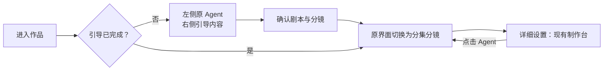

# 短剧简易制作台设计

状态：用户已选择「连续分集浏览」方向（第三版）；首版已接入真实产品，完成代码 review、专项回归与已有作品的浏览器主流程验收。真实模型从引导到制作及付费媒体生成仍待验收，见 `docs/content/docs/progress/pending-test.mdx`。

## 已选页面方向

右侧按集连续分组展示分镜，默认每集展示前六段，可展开其余内容；顶部支持集数和状态筛选。分镜采用紧凑卡片，常规桌面每行约五段，宽屏约六段。左侧始终接续同一 Agent 会话，卡片「AI 交流」先引用当前段。右上角保留「详细设置」，返回时定位到刚才的集与段。

右上角沿用语言、反馈、通知、明暗主题及账户入口。左侧保留图标和文字菜单，10 秒未操作后向左收起为图标栏；鼠标移入或键盘聚焦菜单时展开，离开后重新计时，不额外保留展开按钮。

早期本地交互预览使用演示数据；本次正式实现复用真实项目、会话、编辑弹窗和任务流水线。以下记录首版边界及验收要求。

## 目标

短剧从引导到制作始终使用「左侧 Agent、右侧作品」的同一界面。引导完成后，右侧直接展示按集组织的分镜，不再自动跳转到复杂制作台。用户通过对话完成主要操作，需要精细参数时进入「详细设置」，也能带着当前定位回到简易制作台。

简易与详细制作台共用同一作品、资产、任务和 Agent 会话，不复制业务数据，也不引入另一套生成流水线。

## 页面结构

沿用现有影策主题、黑白主操作、轻灰面板、细分隔线与现有图标体系。参考图仅用于左右布局和分镜卡片组织。

| 区域 | 展示内容与操作 |
| --- | --- |
| 顶栏 | 返回、作品名称、当前阶段；右上角「详细设置」、语言、反馈、通知、主题与账户 |
| 左侧菜单 | 图标与文字；闲置 10 秒收起为图标，鼠标移入或键盘聚焦时展开 |
| 左侧 Agent | 原会话与对话内选项；底部固定输入区，包含可移除的对象引用 |
| 右侧引导内容 | 继续复用现有配置、资产文字、剧本与分镜审阅页 |
| 右侧制作内容 | 集选择、简短任务状态、该集分镜卡片；完整参数不在此展开 |

桌面布局左侧约 360–420px，右侧自适应。分镜网格随可用宽度调整列数，不压缩文字到不可读。窄屏在对话和分镜之间切换视图，保留输入草稿及当前定位。

分镜卡片保留以下内容：

- 缩略图或已有视频预览，生成中的真实状态。
- 「第 N 段 · 场景」及镜头数、时长。
- 两行剧情摘要，完整内容在原编辑弹窗中查看。
- 「AI 交流」和「生成视频」；已有视频时可直接预览。
- 可发现的编辑入口；点击卡片主体或编辑图标，均打开现有分镜编辑弹窗。

**卡片的生成单位保持为现有剧情段（Segment）**，一段包含多个镜头（Shot）。不将每个镜头变成独立视频任务，也不改变原有镜头编辑粒度。

## 连续创作流程

进入作品时，以服务端阶段和实时作品状态决定右侧内容。已完成引导的作品直接进入制作状态，不重新执行首次推荐，不再次要求确认配置。

存量作品可能没有 `production.guideStep`。没有引导草稿且已有制作内容的作品同样直接展示制作分镜，不因缺少 `completed` 字段而跳回详细制作台；无需为此创建新的后端阶段。作品数据尚未加载时先展示加载状态，避免误判后闪跳。

从详细制作台点击 Agent，回到简易制作台，并保留当前集、剧情段及镜头定位。两种视图切换不创建新会话、不清空历史与未发送草稿。前期配置仍遵循已确认的流程：先选风格，其他配置一次给出「采用推荐配置」或「在此基础上修改」；输入型选项原位输入并回车提交。

## 引用与 Agent 操作

点击「AI 交流」只把当前段引用到左侧输入区并聚焦输入框，不自动发送。引用显示为「第 1 集 · 第 2 段」且可移除，用户可以输入「把节奏放慢」「生成这段涉及的角色参考图」「生成视频」。

引用必须绑定真实作品、集、段和内容版本；需要镜头级调整时附带镜头 ID。段号仅用于显示，不能依靠文本段号识别目标。引用后的内容发生变化时，执行前重新读取最新数据。

Agent 的主流程是：读取引用对象 → 检查实际前置条件 → 在回复中给出操作选择 → 用户确认 → 提交现有任务 → 展示真实状态。

例如，用户要求生成视频时：

1. 条件齐全：回复生成范围、费用预估，提供直接确认选项。
2. 缺少必需参考图：说明缺失对象，提供「补齐这些参考图后生成」与调整选项。
3. 模型允许文字生成：可提供「按文字设定生成」，不强迫先生成所有图片。
4. 需要上一段尾帧：说明等待对象；已有任务时复用其状态，不重复创建。
5. 失败：展示明确原因与对应重试，保留成功结果。结果后处理失败优先重放已有结果，避免重复生成。

图片继续由用户明确选择是否生成，文字设定不自动转成图片任务。可执行的选择直接出现在当前回复中；需要补充描述的选项原位输入。不再重复列一段建议文字，再在消息底部附另一组相同操作。

卡片「生成视频」与 Agent 中的生成确认使用同一套预检和执行入口：条件齐全时确认当前段生成；有缺口时转到左侧，引用当前段并解释待补条件。生成中的卡片展示进度，避免重复提交。

## 状态与失败展示

- 作品阶段、集的剧本状态、段提示词状态、视频任务状态分开读取，不能用「段提示词全部完成」表示整部作品完成。
- 未产出分镜的失败集仍可被选择，展示失败原因及「重试本集剧本」，不能因没有卡片而失去重试入口。
- 缺少依赖展示具体原因，如「等待上一段尾帧」；排队与执行中均来自现有任务状态。
- 局部重试只操作当前对象或明确选中的失败对象，不调用项目级全部重试替代。
- 进入详细设置后完成的修改，回到简易台时刷新；Agent 下一次请求读取同一份实时状态。
- 剧本失败与成片合成失败分别展示和重试；合成重试仅恢复当前集的合成作业，复用已有段视频，返回零任务时提示重新检查状态。

## 现有能力复用与必要改动

| 能力 | 复用位置 | 本次必要改动 |
| --- | --- | --- |
| 引导页面和嵌入对话 | `web/src/pages/projects/guide.tsx`、Agent 的 host portal | 引导完成后切换右侧制作视图，保留原会话 |
| 制作数据及状态 | `studio/use-studio.ts`、短剧 summary / episode detail | 复用查询与刷新，协调当前集和段定位 |
| 分镜编辑 | `studio/segment-dialog.tsx` 的 `SegmentDialog` | 简易卡片复用同一弹窗及保存逻辑 |
| 原会话接续 | `studio/use-studio-agent.ts`、`production.guideConversationId` | 详细台 Agent 入口改为视图切换，携带定位 |
| 资产图、段提示词、视频任务 | 现有短剧 API、`DramaJob` 与 dispatcher | 增加统一预检，按用户确认范围提交 |
| 对话内确认 | 现有结构化 proposal 与前端应用机制 | 增加有限的生成、局部重试动作建议 |

视图模式与现有 `view` 参数分开，建议使用独立 `mode=simple|advanced`；当前 `view` 已承担资产、待处理、设置等用途。共享数据及弹窗协调逻辑按实际复用抽取，不复制整份制作台实现。

### 必须修正的生成范围耦合

当前 `GenerateDramaSegments` 会调用 `releaseDramaEpisodes` 放行整集，并为该集全部镜头引用且尚未请求的资产图排队。直接用现有入口实现单卡生成，会产生当前段之外的任务。

实现时需最小拆开「请求指定段视频」和「整集资产放行」，仅处理用户确认的段及依赖资产；保留原队列和计费机制。预检与执行都必须遵守该范围，不能只在 UI 中写「仅当前段」。

### Agent 的最小能力扩展

短剧 Agent 保留读取和提出建议的权限，通过「Agent 输出结构化动作 → 用户在回复内确认 → 宿主调用业务 API」接入媒体生成，不开放通用画布媒体权限。

首期动作限于指定资产生图、指定段生视频、指定段提示词重写、指定失败任务重试及已有视频结果重处理。服务端统一校验对象归属、当前版本、任务范围、模型能力、余额与重复提交；Agent 不自行判断这些事实。

前置条件直接复用实际生成逻辑。参考图是否必需由模型能力决定；样片确认、顺序续接、排队与并发仍沿用原有规则。报价或目标内容变化后重新预检，不复用过期确认。

## 实现任务划分

1. **界面与视图切换**：简易制作壳、分集卡片、原弹窗复用、详细设置往返及定位保持。
2. **Agent 引用与对话操作**：结构化引用、输入草稿、动作建议与回复内确认，接续原会话及实时状态。
3. **生成预检与范围控制**：共用预检、拆开整集放行、复用现有任务和计费、局部失败恢复。

三部分可按预检响应和引用数据合同并行开发，最后联调主流程。不新建通用工作流引擎，不在简易台复制复杂模型参数面板；批量调度面板、剪辑时间线和自动成片扩展不属于首期。

## 主流程验收

- 新作品从引导到制作保持同一界面与会话，完成后不跳入详细制作台。
- 已有作品打开即显示真实制作状态，切换视图不回退引导。
- 卡片编辑与原制作台结果一致；按集切换及返回定位正确。
- AI 引用不自动发送，输入型选项原位填写，回复内操作无重复展示。
- 缺图、文字可生成、等待尾帧、生成中和失败均能由对话正确推进。
- 单段生成不放行整集，不生成确认范围外的图片；已有任务不重复提交。
- 失败集无分镜时仍可重试；单段重试保留其他成功内容。
- 明暗主题、键盘、窄屏及左右独立滚动可用。

实现与专项验证不触发真实图片或视频业务任务；未覆盖的真实模型和媒体路径保留在待测试清单中。

## 首版 review 与验证

Review 已修复：全部集往返详细台丢失筛选范围；完成引导后的文字建议被旧阶段校验拒绝；资产初始版本为零时无法生图；覆盖视频模型时预检仍使用旧模型参数；自动媒体模式扩大到其他资产、其他集，以及旧自动规划在精确操作后继续入队的并发窗口。最后一项使用 `plan → execute → persist` 的两种确定性交错回归验证。发送期间更换引用也不会被旧请求清除。

前端构建、lint、类型检查、真实组件 DOM 专项通过；后端制作台、Agent、文字 CAS、迁移专项及 repository、handler 全包通过。数据库全包通过，三项需真实 PostgreSQL 的用例跳过。本地后端使用原开发数据目录，迁移前已备份，前端和后端 readiness 检查通过。

在真实浏览器用已有 9 集作品验收：1440 宽五列、1920 宽六列、390 宽单列；集与状态筛选、展开本集剩余分镜、打开原分镜弹窗、两台切换后恢复会话、草稿和引用均通过。卡片 AI 交流只引用分镜并聚焦输入。单段视频预检返回操作范围及预计积分，取消后未提交生成任务。验收时修正了制作台 Agent 仍显示前期引导文案的问题；原引导文案和选择行为保持原样。

后续 review 补齐同轮独立建议的版本接续、切换制作视图后的待确认操作恢复、账号重置和迟到回执隔离，以及旧详细深链接切换标签的模式保持。两种视图中镜头操作的迟到回执不再导航回已离开的页面。成片失败使用按集定向合成恢复，复用已有段视频，零任务回执不报告成功。这些修复已通过真实组件 DOM、后端剧集恢复及路由参数专项；未执行真实媒体生成。
